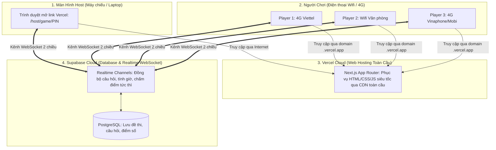

# 📋 KẾ HOẠCH CHI TIẾT: TÙY BIẾN GIAO DIỆN & TRIỂN KHAI QUIZLIVE (KAHOOT SELF-HOST)

Tài liệu này hướng dẫn toàn diện từng bước quy trình làm một ứng dụng web hoàn chỉnh từ môi trường phát triển (Local) đến khi phát hành chính thức trên Internet (Cloud Production), đảm bảo hàng chục người chơi cùng lúc dù dùng mạng **Wifi** hay **4G/5G** đều kết nối siêu tốc thời gian thực.

---

## 🧭 Bức Tranh Tổng Thể: Web Hoạt Động Thế Nào Khi Chơi Qua Wifi & 4G?



> [!NOTE]
> **Tại sao cần đưa lên Vercel + Supabase Cloud thay vì chạy `localhost`?**
> Nếu chạy `localhost` trên máy tính cá nhân, người chơi bật 4G hoặc dùng mạng Wifi khác sẽ **không thể truy cập được**. Khi đưa lên **Vercel** (lấy link công khai `https://du-an-cua-ban.vercel.app`) và **Supabase Cloud**, bất kỳ ai ở bất kỳ đâu có Internet (Wifi, 4G, 5G) đều quét mã QR và chơi mượt mà với độ trễ chỉ tính bằng mili-giây.

---

## 🛠️ Lộ Trình 5 Bước Chi Tiết "Cầm Tay Chỉ Việc"

### GIAI ĐOẠN 1: TÙY BIẾN GIAO DIỆN THEO NHẬN DIỆN THƯƠNG HIỆU MỚI
> **Mục tiêu**: Giữ nguyên 100% logic trò chơi, làm mới giao diện sang trọng chuẩn tác phẩm nghệ thuật Behance.

1. **Đổi font chữ toàn trang sang `Roboto` không chân chuẩn tiếng Việt:**
   - **Tệp:** [src/app/layout.tsx](file:///Users/linhduong/.gemini/antigravity-ide/scratch/kahoot-rep/src/app/layout.tsx) và [src/app/globals.css](file:///Users/linhduong/.gemini/antigravity-ide/scratch/kahoot-rep/src/app/globals.css).
   - Sử dụng font Google `Roboto` với các độ dày nét (`300`, `400`, `500`, `700`, `900`), hỗ trợ đầy đủ ký tự tiếng Việt có dấu.
   - Sửa triệt để lỗi fallback Times New Roman bằng cách định nghĩa biến `--font-sans` chuẩn xác.

2. **Áp dụng bảng màu Behance: Xanh Rêu Trầm + Trắng Ngọc + Cam Đất Nung:**
   - **Tệp:** [src/app/page.tsx](file:///Users/linhduong/.gemini/antigravity-ide/scratch/kahoot-rep/src/app/page.tsx).
   - Nền xanh rêu rừng rậm thanh lịch (`#112017` $\rightarrow$ `#1A3324` $\rightarrow$ `#0D1811`).
   - Tiêu đề chữ trắng ngọc kết hợp dải gradient cam đất ấm (`#FAF8F5` $\rightarrow$ `#EAD1C5` $\rightarrow$ `#C85D3B`).
   - Nút hành động CTA "Vào Chơi Ngay": Màu cam đất nung (Burnt Earth / Terracotta `#B84E2E`), ít tươi, trầm ấm và quyền lực.

3. **Hiệu ứng hạt Grain (Độ nhám sần sùi giấy mỹ thuật):**
   - Lớp texture hạt mịn `.grain-texture` phủ toàn màn hình tạo cảm giác như một ấn phẩm poster in thủ công cao cấp.

4. **Logo "Chú Vịt Vàng Đang Suy Nghĩ 🤔":**
   - **Tệp:** [src/components/common/ThinkingDuckLogo.tsx](file:///Users/linhduong/.gemini/antigravity-ide/scratch/kahoot-rep/src/components/common/ThinkingDuckLogo.tsx).
   - Chú vịt vàng tròn trịa đáng yêu, cánh chống cằm suy ngẫm, mắt to tròn liếc lên, trên đầu có dấu chấm hỏi ý tưởng phát sáng nhấp nháy.
   - Thay thế toàn bộ biểu tượng `K!` cũ trên thanh Header, màn hình Host và màn hình Player.

5. **Căn giữa thanh Header & Hoàn thiện thanh trượt âm lượng:**
   - Header thu gọn về `max-w-5xl mx-auto` với khoảng đệm `px-6 sm:px-10`, không còn bị dạt sát mép màn hình.
   - Thanh trượt âm lượng trang bị con trượt tròn to màu cam đất viền trắng kem, kéo di chuyển êm ái từ 0% đến 100%.

---

### GIAI ĐOẠN 2: THIẾT LẬP CƠ SỞ DỮ LIỆU TRÊN SUPABASE CLOUD (MIỄN PHÍ)
> **Mục tiêu**: Nơi lưu câu hỏi, tính điểm bảo mật và tạo phòng chơi Realtime cho người dùng 4G/Wifi.

1. **Tạo Project mới:**
   - Truy cập [Supabase.com](https://supabase.com) $\rightarrow$ Đăng nhập bằng tài khoản GitHub $\rightarrow$ Nhấn **New Project**.
   - Đặt tên dự án (ví dụ `kahoot-live`), đặt mật khẩu cơ sở dữ liệu.
   - Chọn khu vực (Region): **Southeast Asia (Singapore)** để có tốc độ mạng nhanh và ổn định nhất cho người dùng tại Việt Nam.

2. **Chạy tập lệnh SQL khởi tạo bảng dữ liệu:**
   - Vào thanh menu bên trái $\rightarrow$ chọn **SQL Editor**.
   - Mở tệp [supabase/schema.sql](file:///Users/linhduong/.gemini/antigravity-ide/scratch/kahoot-rep/supabase/schema.sql), sao chép toàn bộ nội dung $\rightarrow$ Dán vào SQL Editor và bấm nút **Run**.
   - Script sẽ tự động tạo các bảng:
     - `quizzes`: Danh sách các bộ câu hỏi.
     - `questions`: Chi tiết từng câu hỏi, hình ảnh, thời gian giới hạn và đáp án đúng.
     - `game_sessions`: Quản lý phòng chơi theo mã PIN 6 chữ số.
     - `players`: Danh sách người chơi tham gia, biệt danh và avatar linh vật.
     - `answers`: Ghi nhận câu trả lời và điểm số tính theo công thức độ trễ.
     - Hàm RPC `submit_player_answer`: Chấm điểm bảo mật phía server, không gửi đáp án đúng về máy người chơi để chống gian lận.

3. **Nạp dữ liệu đề thi mẫu (Tùy chọn):**
   - Mở tệp [supabase/seed.sql](file:///Users/linhduong/.gemini/antigravity-ide/scratch/kahoot-rep/supabase/seed.sql) $\rightarrow$ Dán vào SQL Editor $\rightarrow$ Nhấn **Run** để có sẵn 2 bộ đề thi đấu phong phú.

4. **Lấy 3 thông số API quan trọng:**
   - Vào mục **Project Settings** (biểu tượng bánh răng) $\rightarrow$ Chọn **API**.
   - Ghi lại 3 thông số:
     1. `Project URL` (dạng `https://xxxxxxxxxxxx.supabase.co`)
     2. `anon public key` (chuỗi khóa công khai)
     3. `service_role key` (chuỗi khóa bảo mật dành riêng cho Server Actions)

---

### GIAI ĐOẠN 3: LƯU DỰ ÁN LÊN GITHUB
> **Mục tiêu**: Quản lý phiên bản mã nguồn trên đám mây và kết nối tự động triển khai (CI/CD) với Vercel.

1. **Kiểm tra và chuẩn bị mã nguồn:**
   - Đảm bảo các tệp quan trọng đã được lưu và kiểm tra không còn lỗi:
     ```bash
     npx tsc --noEmit
     ```
2. **Commit các thay đổi:**
   ```bash
   git add .
   git commit -m "feat: cap nhat font Roboto, logo vit vang suy nghi, theme xanh reu cam dat va thanh am luong moi"
   ```
3. **Đẩy lên GitHub:**
   ```bash
   git push origin main
   ```

---

### GIAI ĐOẠN 4: TRIỂN KHAI (DEPLOY) LÊN VERCEL
> **Mục tiêu**: Đưa website lên Internet toàn cầu với giao thức bảo mật HTTPS và tên miền miễn phí.

1. **Đăng nhập Vercel:**
   - Truy cập [Vercel.com](https://vercel.com) $\rightarrow$ Đăng nhập bằng tài khoản GitHub.
2. **Nhập dự án (Import Project):**
   - Nhấn nút **Add New...** $\rightarrow$ Chọn **Project**.
   - Tìm và chọn repository `kahoot-selfhost` (hoặc tên repo của bạn trên GitHub) $\rightarrow$ Nhấn **Import**.
3. **Cấu hình Biến Môi Trường (Environment Variables):**
   - Mở rộng mục **Environment Variables** và điền 3 biến lấy từ Supabase ở Giai đoạn 2:
     - `NEXT_PUBLIC_SUPABASE_URL`: Dán `Project URL` từ Supabase.
     - `NEXT_PUBLIC_SUPABASE_ANON_KEY`: Dán `anon key` từ Supabase.
     - `SUPABASE_SERVICE_ROLE_KEY`: Dán `service_role key` từ Supabase.
4. **Nhấn Deploy:**
   - Vercel sẽ tự động tải thư viện, biên dịch ứng dụng Next.js trong khoảng 1 - 2 phút.
   - Khi hoàn tất, bạn sẽ nhận được đường link chính thức: `https://ten-du-an.vercel.app`.

---

### GIAI ĐOẠN 5: VẬN HÀNH TRẬN ĐẤU THỰC TẾ QUA WIFI & 4G
> **Mục tiêu**: Kiểm tra trải nghiệm thi đấu thực tế giữa Host và Người chơi trên mọi thiết bị.

1. **Phía Quản Trò (Host):**
   - Mở máy tính cá nhân hoặc kết nối màn hình máy chiếu/TV.
   - Truy cập đường dẫn: `https://ten-du-an.vercel.app/host/dashboard`.
   - Nhập mật khẩu bảo vệ mặc định: `8451`.
   - Chọn bộ đề cần thi đấu $\rightarrow$ Bấm **Phát Trực Tiếp**.
   - Màn hình sẽ hiện Sảnh chờ (Lobby) kèm **Mã PIN 6 số** và **Mã QR Code** to rõ cùng nhạc chờ synth sôi động.

2. **Phía Người Chơi (Players):**
   - Cầm điện thoại thông minh (bật 4G hoặc kết nối Wifi bất kỳ).
   - Mở camera quét mã QR trên màn hình chiếu (hoặc truy cập trang chủ và nhập mã PIN).
   - Đặt biệt danh thi đấu $\rightarrow$ Chọn Avatar linh vật yêu thích $\rightarrow$ Nhấn **Sẵn Sàng Tham Gia!**.
   - Màn hình Host lập tức hiển thị avatar và tên người chơi xuất hiện trong sảnh chờ thời gian thực.

3. **Bắt đầu thi đấu:**
   - Host nhấn **Bắt đầu trò chơi**.
   - Màn hình lớn đếm ngược và hiển thị câu hỏi.
   - Màn hình điện thoại người chơi lập tức biến thành tay cầm điều khiển hiển thị 4 nút màu lớn có rung phản hồi khi chạm.
   - Điểm số tự động tính toán dựa trên độ chính xác và tốc độ trả lời.
   - Bảng xếp hạng cập nhật ngay sau mỗi câu và kết thúc với bục vinh danh Podium 3 bậc rực rỡ cùng pháo hoa!

---

## 📌 Bảng Tóm Tắt Trạng Thái Công Việc

| Hạng mục | Trạng thái | Ghi chú |
| :--- | :---: | :--- |
| Font chữ Roboto không chân | ✅ Hoàn thành | Đã nạp font Google hỗ trợ tiếng Việt |
| Background Xanh rêu + Cam đất | ✅ Hoàn thành | Theo phong cách poster Behance |
| Lớp phủ hạt nhám Grain | ✅ Hoàn thành | Paper texture sần sùi nghệ thuật |
| Logo chú vịt vàng suy nghĩ | ✅ Hoàn thành | SVG vector sắc nét, nhún nhảy khi hover |
| Căn giữa Header & Sửa Slider âm lượng | ✅ Hoàn thành | Header thoáng đãng, con trượt to rõ |
| Khởi tạo Supabase Database | ✅ Hoàn thành | Đã chạy schema.sql, seed.sql và cấu hình 3 API Keys |
| Tách mã nguồn độc lập & Đẩy lên GitHub | ✅ Hoàn thành | Kho chính chủ: https://github.com/NhuHaa/quizzzlive-game |
| Triển khai Deploy lên Vercel | ✅ Hoàn thành | Web chính thức: https://quizzzlive-game-35dn.vercel.app |
| Tinh chỉnh Giao diện Quản Trị & Header | ✅ Hoàn thành | Nút xanh lá đồng bộ, căn lề chuẩn, sửa kính lúp tìm kiếm |
| Mascot Vịt vàng Thumbs-Up 👍 nộp bài | ✅ Hoàn thành | Thay thế icon check xanh tránh hiểu lầm đáp án đúng |
| Đồng bộ Xanh Rêu toàn diện (Lobby, Player, Podium) | ✅ Hoàn thành | Xóa bỏ triệt để màu tím, chuẩn nhận diện Behance |
| Sẵn sàng cho trận đấu thực tế | 🚀 Sẵn sàng | Mở Host trên máy tính/TV và quét QR qua điện thoại 4G/Wifi |
